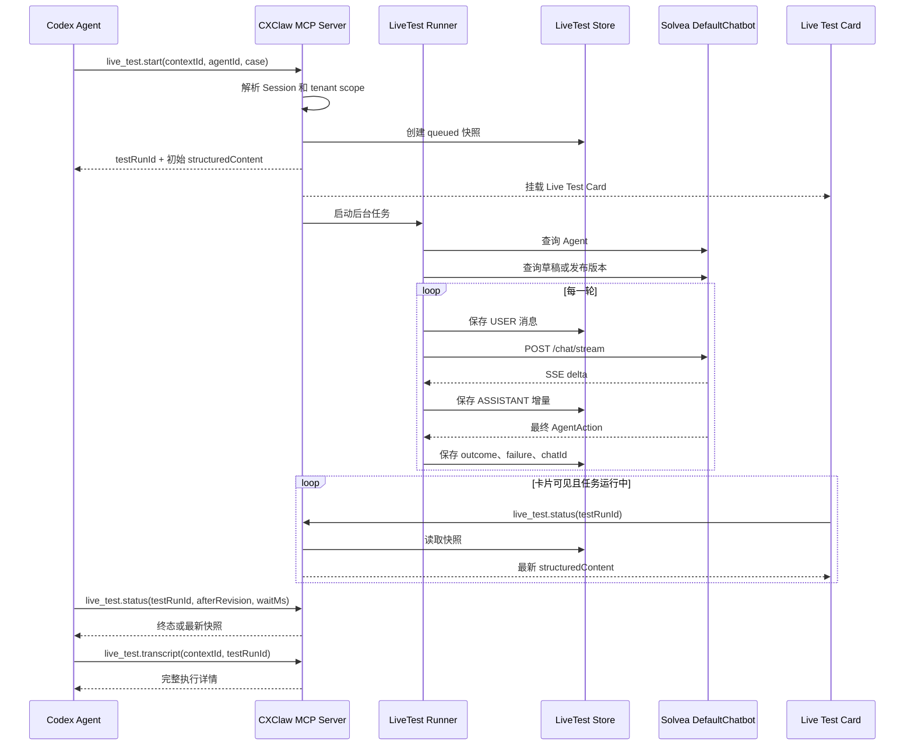

# CXClaw Live Test MCP App 实现方案

## 1. 目标

在 CXClaw Codex 插件中实现 Agent 实时测试卡片，覆盖以下能力：

- 指定 Agent 执行单轮或多轮测试。
- 自动选择当前用户草稿版本；不存在草稿时使用最新发布版本。
- 通过真实 DefaultChatbot 链路执行测试。
- 实时展示用户消息、AI 回复、轮次进度、耗时和错误。
- 返回测试会话 `chatId`，支持查看完整 Agent 执行详情。
- 所有请求继承当前 CXClaw `contextId` 对应的环境、租户和业务凭据。
- 租户信息卡片和测试卡片由同一个 MCP server 提供。
- 所有 MCP App 前端统一使用 Vite、React、Radix UI 和 Tailwind CSS。
- 所有 MCP App 自动跟随 Codex 的光暗主题和宿主样式变量。

`MCP App`（由 MCP tool 返回、直接显示在 Codex 对话中的交互界面）由独立 UI resource、入口 tool 和辅助 tools 组成。

## 2. 总体架构

CXClaw 只启动一个 MCP server。MCP server 按业务域注册多个 MCP App，共享会话解析、租户鉴权、Solvea API client 和错误处理。

```text
CXClaw MCP Server
├── Tenant Status App
│   ├── ui://cxclaw/tenant-status/<content-hash>.html
│   └── tenant.current
│
├── Live Test App
│   ├── ui://cxclaw/live-test/<content-hash>.html
│   ├── live_test.start
│   ├── live_test.status
│   ├── live_test.cancel
│   └── live_test.transcript
│
└── Shared Runtime
    ├── contextId → Session
    ├── tenant scope 校验
    ├── SolveaClient
    ├── tool result 规范化
    └── MCP App resource 加载
```

`tenant scope`（租户范围，就是系统确认一条请求和数据属于当前选中公司）由 MCP server 根据 `contextId` 解析。卡片和模型均不能直接指定业务 token、租户 ID 或 API base URL。

## 3. 核心设计决策

### 3.1 MCP SDK

项目继续使用 `@modelcontextprotocol/server@2.x`：

```ts
import { McpServer } from "@modelcontextprotocol/server";
```

tool 和 resource 使用：

```ts
server.registerTool(...);
server.registerResource(...);
```

所有 `inputSchema` 和 `outputSchema` 使用完整的 `z.object()`，匹配 v2 的标准 overload：

```ts
inputSchema: z.object({
  contextId: z.string(),
}),
```

MCP App 使用标准 `_meta.ui.resourceUri` 绑定 UI resource。`@modelcontextprotocol/ext-apps/server` 的 `registerAppTool()` 依赖 v1 `McpServer` 类型，本方案不在 server 端使用该 helper。浏览器端继续使用 `@modelcontextprotocol/ext-apps` 的 `App`。

### 3.2 MCP App 前端技术栈

所有 MCP App 使用同一套前端基座：

| 层级 | 技术 | 责任 |
|---|---|---|
| 构建 | Vite | React 编译、开发构建、逐 App 生产 bundle |
| UI | React | 组件、状态和生命周期 |
| 交互原语 | Radix UI | Dialog、Tooltip、Tabs、Progress 等无样式可访问组件 |
| 样式 | Tailwind CSS | 布局、排版、状态和响应式样式 |
| MCP bridge | `@modelcontextprotocol/ext-apps` | tool result、tool call、host context 和自动高度 |

前端源码集中在 `mcp-apps/`，MCP server 只负责读取 Vite 构建产物并包装为 `text/html;profile=mcp-app` resource。

生产构建使用 ES module，并内联到 resource HTML：

```html
<div id="root"></div>
<style>/* dist/mcp-apps/style.css */</style>
<script type="module">/* 对应 App 的 Vite bundle */</script>
```

每个 MCP App 拥有独立 React entry，共享 theme provider、MCP bridge hooks、Tailwind theme 和基础 UI 组件。统一构建脚本逐 App 执行单入口 Vite build，使每个 resource 的 JS 和 CSS 均可独立内联。

### 3.3 Codex 光暗主题

MCP App 以宿主 `hostContext` 为唯一主题来源：

```tsx
import {
  applyDocumentTheme,
  applyHostStyleVariables,
  type App,
} from "@modelcontextprotocol/ext-apps";

export function bindHostTheme(app: App): () => void {
  const apply = () => {
    const context = app.getHostContext();
    if (context?.theme) applyDocumentTheme(context.theme);
    if (context?.styles?.variables) {
      applyHostStyleVariables(context.styles.variables);
    }
  };

  const onChange = () => apply();
  apply();
  app.addEventListener("hostcontextchanged", onChange);
  return () => app.removeEventListener("hostcontextchanged", onChange);
}
```

`applyDocumentTheme()` 将主题写入 `document.documentElement[data-theme]` 并更新 `color-scheme`。Tailwind 使用该属性作为 dark variant：

```css
@import "tailwindcss";

@custom-variant dark (&:where([data-theme="dark"], [data-theme="dark"] *));

@theme inline {
  --color-app-background: var(--color-background-primary, Canvas);
  --color-app-surface: var(--color-background-secondary, ButtonFace);
  --color-app-foreground: var(--color-text-primary, CanvasText);
  --color-app-muted: var(--color-text-secondary, GrayText);
  --color-app-border: var(--color-border-secondary, ButtonBorder);
  --color-app-ring: var(--color-ring-primary, Highlight);
  --color-app-danger: var(--color-text-danger, LinkText);
  --font-app-sans: var(--font-sans, ui-sans-serif, system-ui, sans-serif);
  --font-app-mono: var(--font-mono, ui-monospace, monospace);
}
```

组件使用语义 class：

```tsx
<main className="bg-app-background font-app-sans text-app-foreground">
  <section className="border-app-border bg-app-surface">
    <p className="text-app-muted">Agent 测试中</p>
  </section>
</main>
```

宿主通过 `ui/notifications/host-context-changed` 更新主题时，所有已挂载卡片立即切换。业务状态色优先使用宿主的 `info`、`success`、`warning`、`danger` CSS variables。

### 3.4 一个入口 tool 对应一张卡片

只有创建界面的入口 tool 绑定 UI resource：

| App | 入口 tool | UI resource | 展示方式 |
|---|---|---|---|
| Tenant Status | `tenant.current` | `ui://cxclaw/tenant-status/<content-hash>.html` | 登录并选择租户后显式调用 |
| Live Test | `live_test.start` | `ui://cxclaw/live-test/<content-hash>.html` | tool result card |

Live Test 辅助 tools 不绑定 UI resource：

- `live_test.status`
- `live_test.cancel`
- `live_test.transcript`

卡片调用辅助 tool 时只更新当前界面，不创建新的测试卡片。

### 3.5 异步任务模型

Live Test 使用“创建任务 + 查询状态”模型：

1. `live_test.start` 创建测试任务并立即返回初始卡片。
2. MCP server 在后台顺序执行测试轮次。
3. 卡片调用 `live_test.status` 获取最新快照。
4. Codex Agent 使用 `live_test.status` 的 long polling（请求可以等待状态变化后再返回）等待任务终态。
5. 测试完成后，Codex Agent 调用 `live_test.transcript` 获取完整执行详情。

该模型不依赖一次 MCP tool 调用持续存活，卡片重新挂载后也能恢复任务状态。

## 4. 调用链路



`SSE`（服务端生成一段内容就推送一段，不需要等待完整响应）只存在于 CXClaw MCP server 与 Solvea DefaultChatbot 之间。MCP App 通过状态快照获得可恢复的实时展示。

## 5. MCP tools

### 5.1 `tenant.current`

租户卡片只在登录、初始化 context 并选择租户后显式创建。每次切换租户后，使用同一个会话的 `contextId` 重新调用。

```ts
inputSchema: z.object({
  contextId: z.string().min(1),
}),
outputSchema: TenantPanelStatusSchema,
```

tool metadata：

```ts
{
  ui: {
    resourceUri: "ui://cxclaw/tenant-status/<content-hash>.html",
    visibility: ["model", "app"],
  },
}
```

### 5.2 `live_test.start`

#### 输入

```ts
const LiveTestStartInputSchema = z
  .object({
    contextId: z.string().min(1),
    agentId: z.number().int().positive(),
    botId: z.number().int().positive().optional(),
    flowVersion: z.number().int().optional(),
    touchPoint: z.string().default("LIVE_CHAT"),
    case: z
      .object({
        caseId: z.string().optional(),
        turns: z
          .array(z.object({ message: z.string().min(1) }))
          .min(1)
          .max(10),
      })
      .optional(),
    message: z.string().min(1).optional(),
    chatId: z.string().optional(),
    metadata: z.record(z.string(), z.unknown()).default({}),
    option: z.record(z.string(), z.unknown()).default({}),
  })
  .superRefine((value, context) => {
    if (Boolean(value.case) === Boolean(value.message)) {
      context.addIssue({
        code: "custom",
        message: "case.turns 和 message 必须且只能提供一个",
      });
    }
  });
```

固定测试使用 `case.turns`。探索式续聊使用 `message + chatId`。

#### 输出

```ts
{
  testRunId: string;
  snapshot: LiveTestSnapshot;
}
```

#### annotations

```ts
{
  readOnlyHint: false,
  destructiveHint: false,
  idempotentHint: false,
  openWorldHint: false,
}
```

该工具会创建 DefaultChatbot 测试会话，因此属于写操作。

#### UI metadata

```ts
{
  ui: {
    resourceUri: "ui://cxclaw/live-test/<content-hash>.html",
    visibility: ["model", "app"],
  },
}
```

### 5.3 `live_test.status`

#### 输入

```ts
const LiveTestStatusInputSchema = z.object({
  contextId: z.string().min(1),
  testRunId: z.string().min(1),
  afterRevision: z.number().int().min(0).optional(),
  waitMs: z.number().int().min(0).max(30_000).default(0),
});
```

- 卡片使用 `waitMs=0` 获取当前快照。
- Codex Agent 使用 `afterRevision + waitMs=30_000` 等待状态变化。
- 达到终态后立即返回。

annotations：

```ts
{
  readOnlyHint: true,
  destructiveHint: false,
  idempotentHint: true,
  openWorldHint: false,
}
```

### 5.4 `live_test.cancel`

输入：

```ts
z.object({
  contextId: z.string().min(1),
  testRunId: z.string().min(1),
})
```

处理逻辑：

1. 校验任务属于当前 `contextId` 和 profile。
2. 调用任务对应的 `AbortController.abort()`。
3. 将任务更新为 `cancelled`。
4. 重复取消直接返回当前终态。

### 5.5 `live_test.transcript`

输入：

```ts
z.object({
  contextId: z.string().min(1),
  testRunId: z.string().min(1),
})
```

服务端从测试快照读取 `chatId`，然后调用现有 `SolveaClient.transcript()`。客户端不直接传任意 `chatId`，确保详情请求仍受测试任务归属校验保护。

## 6. 测试快照

```ts
type LiveTestStatus =
  | "queued"
  | "resolving"
  | "running"
  | "succeeded"
  | "failed"
  | "cancelled"
  | "interrupted";

type LiveTestSnapshot = {
  revision: number;
  testRunId: string;
  status: LiveTestStatus;

  contextId: string;
  profileId: string;
  accountId: number;
  environment: string;

  agentId: number;
  agentName?: string;
  botId?: number;
  flowVersion?: number;
  chatId?: string;

  turns: LiveTestTurn[];
  error?: string;
  failedNodeId?: string;
  failedNodeTitle?: string;
  truncated: boolean;

  createdAt: number;
  updatedAt: number;
};

type LiveTestTurn = {
  index: number;
  user: string;
  assistant: string;
  status: "queued" | "running" | "succeeded" | "failed" | "cancelled";
  startedAt?: number;
  completedAt?: number;
  messageId?: string;
  error?: string;
};
```

每次快照变化递增 `revision`。完整快照编码后限制为 `32 KiB`，超限时从最长消息开始截断，并设置 `truncated: true`。

## 7. Live Test Runner

### 7.1 测试目标解析

1. 根据 `contextId` 获取最新认证会话。
2. 创建绑定当前租户的 `SolveaClient`。
3. 调用 `getAgent(agentId)` 获取 Agent 和名称。
4. 未传 `botId` 时使用当前项目 Bot。
5. 未传 `flowVersion` 时调用 `getChatflowGraph(agentId)`：
   - 存在当前用户草稿时使用草稿版本。
   - 不存在草稿时使用最新发布版本。
   - 接口无版本时回退 `agent.meta.chatFlowVersion`。
6. 仍无法确定版本时终止任务并返回明确错误。

### 7.2 请求保护字段

外部传入的以下字段会被过滤：

```ts
const PROTECTED_METADATA_KEYS = new Set([
  "specified_agent_id",
  "specified_flow_version",
  "show_chat_flow",
]);

const PROTECTED_OPTION_KEYS = new Set(["debug", "verbose"]);
```

Runner 固定注入：

```ts
metadata: {
  ...safeMetadata,
  specified_agent_id: agentId,
  specified_flow_version: flowVersion,
  show_chat_flow: true,
},
option: {
  ...safeOption,
  debug: true,
  verbose: true,
},
```

### 7.3 多轮执行

- 所有轮次严格顺序执行。
- 第一轮使用输入中的 `chatId`；后续轮次使用上一轮返回的 `chatId`。
- 每轮开始前写入 USER 消息。
- `LIVE_CHAT` 使用流式接口；其他 touch point 使用同步接口。
- 每轮完成后保存最终 ASSISTANT 消息、`messageId`、耗时和 `AgentAction` 结果。
- 任一轮失败后停止后续轮次。

### 7.4 失败识别

以下情况判定为测试失败：

- `AgentAction.reason === "SYSTEM_ERROR"`。
- `AgentAction.reasonList` 包含 `SYSTEM_ERROR`。
- `contextComparison.chatContext.ext.chatflow_run_info` 存在 `status === "failed"` 的节点。
- `context.chatContext.ext.chatflow_run_info` 存在 `status === "failed"` 的节点。
- 流结束时没有最终 `AgentAction`。
- HTTP、SSE、超时或参数校验失败。

失败快照包含节点 ID、节点标题、错误类型和错误信息。

## 8. SolveaClient 流式接口

新增真正增量读取的接口：

```ts
async chatStreamTrace(
  data: JsonObject,
  callbacks: {
    onDelta?: (text: string) => void | Promise<void>;
    onEvent?: (event: JsonObject) => void | Promise<void>;
  },
  signal?: AbortSignal,
): Promise<JsonObject>
```

实现要求：

- 使用 `response.body.getReader()` 逐块读取。
- 使用 `TextDecoder` 保留跨 chunk 的半段文本。
- 正确解析空行分隔的 SSE event。
- 支持一个 event 中的多个 `data:` 行。
- 从 `event.data.content`、`event.data.delta`、`event.data.text` 和顶层 `event.content` 提取增量。
- 捕获 `isEnd=true` 对应的最终 `AgentAction`。
- 30 秒无新数据触发 idle timeout。
- 单轮整体执行上限为 120 秒。
- 支持外部 `AbortSignal` 取消。

现有 `chatStream()` 保持兼容，可在内部调用 `chatStreamTrace()` 并忽略增量回调。

## 9. 状态存储

### 9.1 路径

```text
~/.cxclaw/workspace/state/agent-tester/live-test/
└── <profileId>/
    └── <testRunId>.json
```

测试快照只保存运行恢复所需的数据，不保存 token、Cookie、业务 base URL 和完整 HTTP 报文。

### 9.2 内存状态

```ts
type ActiveLiveTest = {
  promise: Promise<void>;
  abortController: AbortController;
};

const activeRuns = new Map<string, ActiveLiveTest>();
```

### 9.3 写入规则

- 使用临时文件写入完整 JSON，再通过 `rename` 原子替换。
- 单个 `contextId` 同时只运行一个 Live Test。
- 状态查询同时校验 `contextId`、`profileId` 和 `accountId`。
- MCP server 启动时将遗留的 `queued/running` 任务更新为 `interrupted`。
- 终态任务默认保留 24 小时，启动时和创建任务时执行过期清理。
- 运行日志只记录 `testRunId`、`agentId`、`chatId`、`tenantId`、状态和耗时。

## 10. Live Test 卡片

Live Test 卡片使用 React 组件实现。进度、详情弹层、Tooltip 和 Tabs 使用 Radix UI primitives，视觉样式统一通过 Tailwind CSS 和宿主语义 token 实现。

### 10.1 展示内容

- Agent 名称和 `agentId`。
- `botId`、`flowVersion`、`touchPoint`。
- 当前进度和总轮数。
- USER/ASSISTANT 消息气泡。
- 当前 AI 流式回复。
- 每轮状态和耗时。
- `handoff`、`reason`、`reasonDesc`、`explain`。
- 失败节点和错误信息。
- 最终 `chatId`。

### 10.2 操作

- `刷新`：立即调用 `live_test.status`。
- `停止测试`：调用 `live_test.cancel`。
- `查看执行详情`：调用 `live_test.transcript` 并在卡片中展示详情。
- 执行节点仅在包含输入、输出、工具明细或错误时显示展开入口。
- 处理方式中的 Agent/Chatflow 和真实 Chatflow 节点通过 `ui/open-link` 在系统浏览器打开对应租户环境的详情页。
- `让 Codex 分析`：发送包含 `testRunId` 和 `chatId` 的 follow-up message，由 Codex 读取 transcript 后分析。

### 10.3 状态刷新

- `queued/running` 状态下每秒查询一次。
- 页面不可见时停止定时查询。
- 页面重新可见或窗口获得焦点时立即刷新。
- 达到终态后停止查询。
- 网络错误使用 1、2、4、8 秒退避，最大间隔 10 秒。

`widgetState` 只保存当前展开轮次、详情展开状态等界面选择。测试结果始终以 `live_test.status` 返回的快照为准。

## 11. 代码结构

```text
src/mcp/
├── server.ts
├── shared/
│   ├── session.ts
│   ├── panel-resource.ts
│   └── tool-result.ts
└── apps/
    ├── tenant-status/
    │   ├── contract.ts
    │   ├── register.ts
    │   └── service.ts
    └── live-test/
        ├── contract.ts
        ├── register.ts
        ├── runner.ts
        ├── service.ts
        └── store.ts

mcp-apps/
├── vite.config.ts
├── src/
│   ├── shared/
│   │   ├── app-provider.tsx
│   │   ├── host-theme.tsx
│   │   ├── mcp-hooks.ts
│   │   ├── styles.css
│   │   └── ui/
│   ├── tenant-status/
│   │   ├── main.tsx
│   │   └── tenant-status-app.tsx
│   └── live-test/
│       ├── main.tsx
│       └── live-test-app.tsx
└── tests/
```

`server.ts` 只负责创建 server 和组装 App：

```ts
export function createCxclawMcpServer(): McpServer {
  const server = new McpServer({ name, version: VERSION });
  new OpenAIExtensions(server);

  registerTenantStatusApp(server);
  registerLiveTestApp(server);

  return server;
}
```

`.mcp.json` 中现有 server ID `tenant-panel` 保持不变，避免改变已安装插件的 MCP tool 标识。内部函数和模块统一使用 `cxclaw` 命名。

## 12. 构建与发布

Node.js CLI 和 MCP server 继续由 `tsup` 构建。所有 MCP App 浏览器代码由 Vite 构建。

根 `package.json` 提供统一命令：

```json
{
  "scripts": {
    "build:server": "tsup",
    "build:mcp-apps": "tsx scripts/build-mcp-apps.ts",
    "build": "bun run build:server && bun run build:mcp-apps",
    "dev:mcp-apps": "tsx scripts/build-mcp-apps.ts --watch"
  }
}
```

`scripts/build-mcp-apps.ts` 维护 App entry 清单，并使用同一份 `mcp-apps/vite.config.ts` 逐 App 执行单入口构建。每个 App 输出到 `dist/mcp-apps/<app-name>/`，开启 `inlineDynamicImports`，独立生成 manifest、JS 和 CSS，不产生跨 App 共享 chunk。

`mcp-apps/vite.config.ts` 提供配置工厂：

```ts
import react from "@vitejs/plugin-react";
import tailwindcss from "@tailwindcss/vite";
import { defineConfig } from "vite";
import { resolve } from "node:path";

export function createMcpAppConfig(appName: string, entry: string) {
  return defineConfig({
    root: resolve(import.meta.dirname),
    plugins: [react(), tailwindcss()],
    build: {
      outDir: resolve(import.meta.dirname, `../dist/mcp-apps/${appName}`),
      emptyOutDir: true,
      manifest: "manifest.json",
      cssCodeSplit: false,
      rollupOptions: {
        input: resolve(import.meta.dirname, entry),
        output: {
          format: "es",
          inlineDynamicImports: true,
          entryFileNames: `${appName}.js`,
          assetFileNames: `${appName}[extname]`,
        },
      },
    },
  });
}
```

依赖统一放在根 `package.json`：

```json
{
  "dependencies": {
    "@modelcontextprotocol/ext-apps": "^1.7.5",
    "@radix-ui/react-dialog": "^1",
    "@radix-ui/react-progress": "^1",
    "@radix-ui/react-tabs": "^1",
    "@radix-ui/react-tooltip": "^1",
    "react": "^19",
    "react-dom": "^19"
  },
  "devDependencies": {
    "@tailwindcss/vite": "^4",
    "@vitejs/plugin-react": "^5.1.1",
    "tailwindcss": "^4",
    "vite": "^7.2.2"
  }
}
```

Radix UI 按实际使用的 primitive 安装独立 package，控制浏览器 bundle 体积。

`package.json` 发布文件包含整个前端产物目录：

```json
"dist/mcp-apps"
```

MCP resource 返回：

```ts
{
  uri: "ui://cxclaw/live-test/<content-hash>.html",
  mimeType: "text/html;profile=mcp-app",
  text: await loadMcpAppHtml("live-test"),
}
```

`loadMcpAppHtml()` 从对应 App 的 Vite manifest 读取 entry 和 CSS，生成可内联的 resource HTML。所有脚本和样式随插件本地发布，不依赖外部 CDN。

## 13. Skill 接入

删除 `skills/agent-tester/SKILL.md` 中的：

```yaml
requires:
  libs: [solvea-api]
```

新增：

```text
skills/agent-tester/agents/openai.yaml
```

声明 `agent-tester` 使用的 tools：

```yaml
interface:
  display_name: "Agent Tester"
  short_description: "测试和回归 Shulex Agent"
  default_prompt: "测试指定的 Shulex Agent，并分析执行结果。"

policy:
  products: [CODEX]
  allow_implicit_invocation: true

dependencies:
  tools:
    - "live_test.start"
    - "live_test.status"
    - "live_test.cancel"
    - "live_test.transcript"
```

单测文档执行顺序统一为：

```text
live_test.start
  → live_test.status，等待终态
  → live_test.transcript
  → 分析 AgentAction
```

超过 10 个 case 的测试继续使用现有系统批测和下载中心链路。

## 14. 文件改动清单

| 文件 | 改动 |
|---|---|
| `src/mcp/server.ts` | 改为多 App 组装入口 |
| `src/mcp/shared/session.ts` | 统一解析 `contextId` 和租户会话 |
| `src/mcp/shared/panel-resource.ts` | 统一读取和嵌入浏览器 bundle |
| `src/mcp/apps/tenant-status/*` | 迁移现有租户业务逻辑，补全 Schema |
| `src/mcp/apps/live-test/contract.ts` | Live Test 输入、输出和快照 Schema |
| `src/mcp/apps/live-test/register.ts` | 注册 resource 和 4 个 tools |
| `src/mcp/apps/live-test/runner.ts` | 多轮测试和失败识别 |
| `src/mcp/apps/live-test/store.ts` | 状态持久化和租户校验 |
| `src/mcp/apps/live-test/service.ts` | start/status/cancel/transcript 服务入口 |
| `mcp-apps/src/shared/*` | MCP bridge、宿主主题、Tailwind token 和共享 UI |
| `mcp-apps/src/tenant-status/*` | React 租户卡片 |
| `mcp-apps/src/live-test/*` | React Live Test 卡片 |
| `mcp-apps/vite.config.ts` | MCP App 共用 Vite 配置工厂 |
| `scripts/build-mcp-apps.ts` | 逐 App 执行单入口构建和 watch |
| `scripts/dev-plugin.ts` | 统一编排 MCP server 与 MCP App 开发构建 |
| `src/solvea/client.ts` | 增加真实 SSE 增量解析 |
| `tsup.config.ts` | 只构建 Node.js CLI 和 MCP server |
| `package.json` | 增加前端依赖、构建命令和 MCP App 产物 |
| `skills/agent-tester/SKILL.md` | 移除 `requires.libs` |
| `skills/agent-tester/agents/openai.yaml` | 声明工具依赖和 Skill 界面 |
| `skills/agent-tester/single-test/*.md` | 更新工具调用契约 |

## 15. 测试方案

### 15.1 Contract 测试

- `case` 和 `message` 二选一。
- 多轮 case 为 1 至 10 轮。
- `contextId`、`agentId` 必填。
- 所有 tool 的 `inputSchema` 和 `outputSchema` 均为完整 `z.object()`。
- `structuredContent` 能通过输出 Schema 校验。

### 15.2 Runner 测试

- 自动选择当前用户草稿版本。
- 无草稿时回退发布版本。
- 外部 metadata 无法覆盖保护字段。
- 外部 option 无法关闭 `debug/verbose`。
- 多轮严格串行并复用 `chatId`。
- `SYSTEM_ERROR` 正确失败。
- Chatflow 失败节点正确提取。
- `handoff` 和空回复正确记录。
- payload 超限时正确截断。

### 15.3 SSE 测试

- 单个 event 被拆成多个 chunk。
- 一个 chunk 包含多个 event。
- event 包含多个 `data:` 行。
- 非 JSON event 被忽略。
- API 错误正确转换。
- 无最终 `AgentAction` 时失败。
- idle timeout、整体 timeout 和主动取消生效。

### 15.4 Store 与租户隔离测试

- 原子写入后能读取完整快照。
- 不同 `contextId` 无法读取同一任务。
- 不同 profile 无法读取同一任务。
- 进程重启后运行中任务变为 `interrupted`。
- 过期终态任务被清理。
- 同一 context 的并发测试被拒绝。

### 15.5 卡片测试

- React 组件在 light 和 dark 两种 host theme 下正确渲染。
- `hostcontextchanged` 到达后无需重新挂载即可切换主题。
- 宿主 CSS variables 正确映射到 Tailwind 语义 token。
- Radix UI portal、focus trap 和键盘操作正常。
- 初始 `queued` 状态正确显示。
- revision 变化后正确合并消息。
- 页面隐藏时停止查询。
- 页面恢复可见后立即刷新。
- 终态后停止查询。
- 取消、刷新和执行详情按钮调用正确 tool。
- 错误、失败节点和 `chatId` 正确显示。

### 15.6 集成验收

1. 安装开发版插件并完成登录。
2. 初始化独立 `contextId`，选择测试租户并通过 `context current` 确认。
3. 使用当前 `contextId` 调用 `tenant.current`，租户卡片正常显示。
4. 调用 `live_test.start`，生成独立测试卡片。
5. 卡片逐轮显示 USER 和 ASSISTANT 内容。
6. Codex Agent 通过 `live_test.status` 等待终态。
7. 测试完成后获得新 `chatId`。
8. `live_test.transcript` 返回对应完整会话。
9. 租户卡片与测试卡片在同一对话中互不影响。
10. `bun run typecheck`、`bun test`、`bun run build` 和 `bun run test:package` 全部通过。

## 16. 实施顺序

1. 建立 Vite、React、Radix UI、Tailwind CSS 的 MCP App 前端基座。
2. 实现共享 MCP bridge、host theme provider 和语义 token。
3. 整理 MCP server 多 App 目录和共享 session 解析。
4. 将租户卡片迁移为 React App，补全 Zod Schema，并绑定当前会话 `contextId`。
5. 实现 Live Test contract 和 store。
6. 实现 `SolveaClient.chatStreamTrace()`。
7. 实现 Runner 和失败识别。
8. 注册 Live Test resource 和 tools。
9. 实现 Live Test React 卡片。
10. 更新 `agent-tester` Skill 和工具依赖。
11. 完成单元测试、光暗主题测试、集成测试和插件打包验证。

## 17. 完成标准

- CXClaw 只启动一个 MCP server。
- 所有 MCP App 使用 Vite、React、Radix UI 和 Tailwind CSS。
- 所有 MCP App 首次渲染和运行时切换均跟随 Codex 光暗主题。
- `tenant.current` 只接受当前会话的显式 `contextId`，未登录时不自动弹出卡片。
- `live_test.start` 能创建测试卡片并在 1 秒内返回初始状态。
- 多轮测试复用同一个 `chatId`。
- 卡片能持续展示 AI 增量回复和轮次状态。
- Codex Agent 能可靠等待测试终态并读取 transcript。
- 测试目标版本、保护 metadata 和调试参数由服务端强制控制。
- 所有任务查询都通过 `contextId` 和 profile 执行租户隔离。
- 任务恢复、取消、超时和错误状态完整可见。
- 插件构建、测试和打包全部通过。
