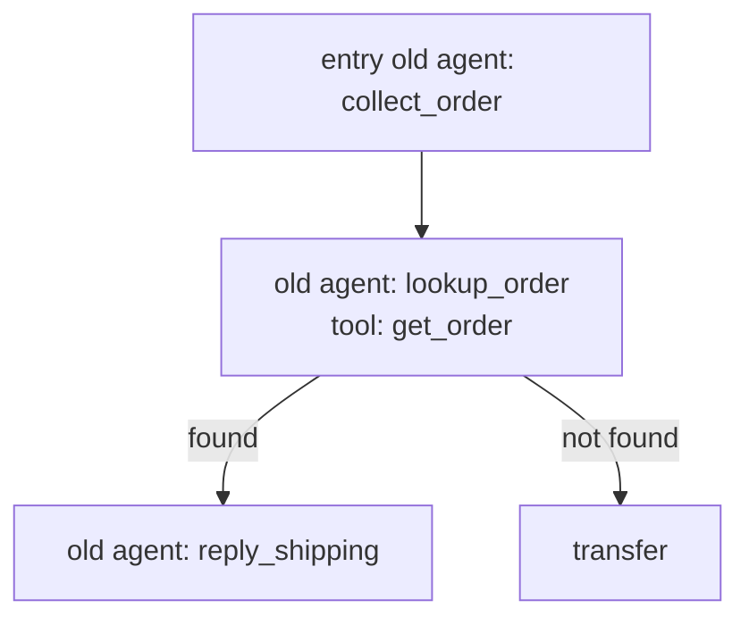

# MULTI_AGENT Create / Update

Deprecated：本文件是旧版 create/update 说明，保留用于历史引用。当前规则以 `overview.md` 和
`workflow.md` 为准：不支持新建 `MULTI_AGENT`；用户要求新建多节点流程时切到 `../chatflow/overview.md`。
只有用户明确要求维护已有 `MULTI_AGENT` 时，读取 `workflow.md`、`graph-spec.md` 和 `update.md`。

## 触发条件

符合任一条件才进入本文件：

- 用户要求更新一个已有 `MULTI_AGENT`，且提供 agent_id 或完整旧 JSON
- 用户明确不要 CHAT_FLOW，而要旧 multi-agent 形态

如果用户只是说“多节点、多分支、流程图、工具状态分支”，但没有明确指定 MULTI_AGENT，回到 `../chatflow/overview.md`。

## 用户需求理解

创建或更新前，先把需求整理成结构化设计，不直接写 payload。

必须确认：

- 业务目标：这个 agent 解决什么问题
- 入口 agent：用户第一句话进入哪个 agent
- 子 agent 职责：每个 agent 的名称、角色、prompt 目标
- 工具：每个 agent 绑定哪些真实 `usedPlugins`，工具 id 是否已存在
- 工具状态分支：`actionStatuses` 和每个 status 后的 action
- 显式边：是否需要 `agentEdges`
- 模板回复：template id / template content 来源
- 转人工：哪些场景转人工，是否先回复
- 结束：哪些场景 finish，是否先回复
- KB：是否启用、目录 id、标签 id；只有已启用或启用状态未知且目录缺失时才提 `open_questions`，明确未启用只保留审计
- 兜底：未知意图、工具异常、用户信息不足时怎么处理

输出给用户确认时必须包含 Mermaid：



用户未确认 Mermaid、agent 清单、工具清单和 action 清单前，不调用 create / update。

## 存量更新流程

1. 读 `overview.md`、`workflow.md`、`graph-spec.md` 和 `update.md`。
2. 若涉及工具，按 `../tools/overview.md` 查工具 id 和完整配置。
3. 写 payload 到：

```text
/workspace/state/agent-builder/multi-agent/create_<name>_payload.json
```

4. 向用户展示摘要和 Mermaid，请用户确认。
5. 用户确认后执行：

```bash
npx --yes @shulex/cxclawctl@latest api create-agent \
  --data-file /workspace/state/agent-builder/multi-agent/create_<name>_payload.json \
  --pretty
```

## 最小 Payload

```json
{
  "name": "Shipping_Inquiry_Multi",
  "type": "MULTI_AGENT",
  "category": "TEXT",
  "source": "MANUAL",
  "prompt": "",
  "displayPrompt": "",
  "usedPlugins": [],
  "meta": {
    "multiAgentGraph": {
      "entryAgentId": "agent_collect_order",
      "agents": [
        {
          "id": "agent_collect_order",
          "name": "collect_order",
          "type": "AGENT",
          "prompt": "Collect the order number from the customer.",
          "displayPrompt": "Collect the order number from the customer.",
          "usedPlugins": [],
          "meta": {}
        }
      ],
      "agentEdges": [],
      "displayData": {}
    }
  }
}
```

实际创建时必须用服务端接受的 id 格式。若没有可复用旧 id，先用稳定字符串 id 生成草稿并请用户确认；如果环境要求数字 id，则在 create 前改为符合旧引擎约束的 id。

## Tool Action 示例

外部工具分支必须放在工具配置的 `toolAfterExecuteActions`，不要只写进 prompt：

```json
{
  "id": 8299,
  "name": "get_order_info",
  "type": "EXTERNAL_HTTP_CALL",
  "meta": {
    "externalHttpCallConfig": {
      "requestParam": {"items": []},
      "responseParam": {"items": []},
      "actionStatuses": [
        {"name": "ORDER_FOUND", "condition": {"and": []}},
        {"name": "ORDER_NOT_FOUND", "condition": {"or": []}}
      ]
    },
    "toolAfterExecuteActions": [
      {
        "matchStatus": "ORDER_FOUND",
        "actions": [{"type": "SWITCH_AGENT", "value": "agent_reply_order"}]
      },
      {
        "matchStatus": "ORDER_NOT_FOUND",
        "actions": [{"type": "TRANSFER_TO_HUMAN"}]
      }
    ]
  }
}
```

## 更新流程

更新已有 MULTI_AGENT 必须先取完整对象，不允许只提交局部 patch：

```bash
npx --yes @shulex/cxclawctl@latest api get-agent --id <agent_id> --pretty
```

将完整对象保存到：

```text
/workspace/state/agent-builder/multi-agent/update_<agent_id>_payload.json
```

修改后展示 diff 摘要和 Mermaid，请用户确认。确认后执行：

```bash
npx --yes @shulex/cxclawctl@latest api update-agent \
  --data-file /workspace/state/agent-builder/multi-agent/update_<agent_id>_payload.json \
  --pretty
```

约束：

- `agentId` 必须等于 `id`
- `type` 必须保持 `MULTI_AGENT`
- 不删除未知字段；完整对象更新时保留服务端已有字段
- 修改 prompt 时同步 `prompt` 和 `displayPrompt`，但不要插入 `{{Template_Reply}}` 这类旧编辑器占位符
- 工具 id 必须真实存在；先 `get-plugin`
- action 目标 agent 必须存在于 `multiAgentGraph.agents[]`
- 新增 template / KB / transfer 行为必须写出 open question 和用户确认

## 创建 / 更新结果

执行成功后必须告诉用户：

```text
=== MULTI_AGENT Result ===
Action: create/update
Agent: <id> "<name>"
Agents: N
Tools: N
Explicit agentEdges: N
Tool action edges: N
Template replies: N
Transfer actions: N
Finish actions: N
Open questions resolved: N
```

如果用户后续要迁到 CHAT_FLOW，再切到 `workflow.md` 的“迁移到 CHAT_FLOW”，并按 `migration/principles.md`
与 `migration/large.md` / `migration/small.md` 执行。
